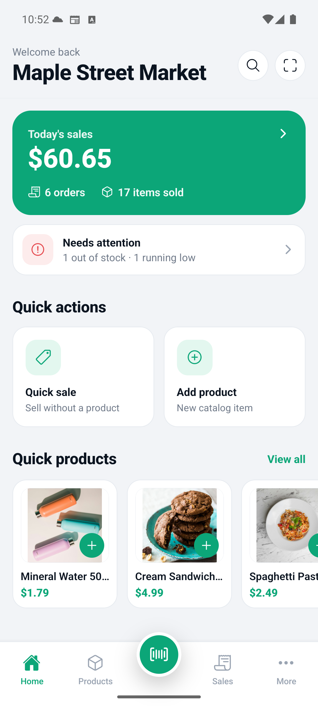
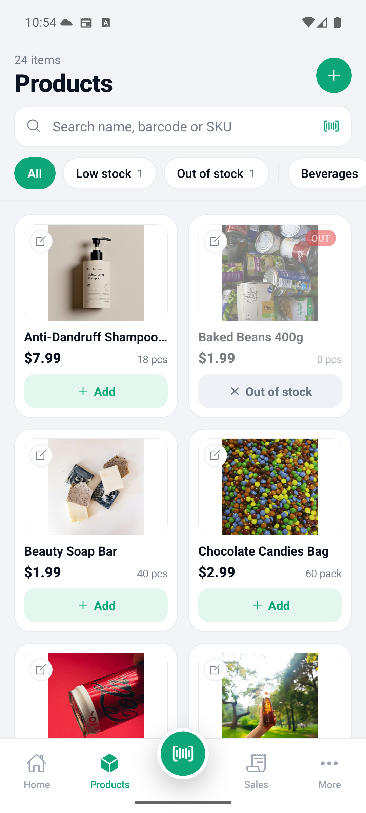
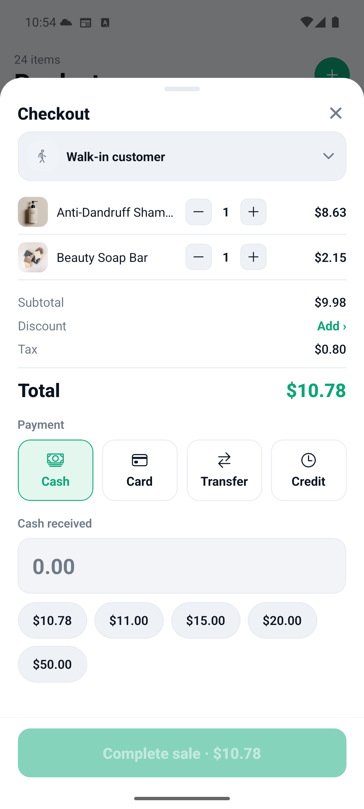
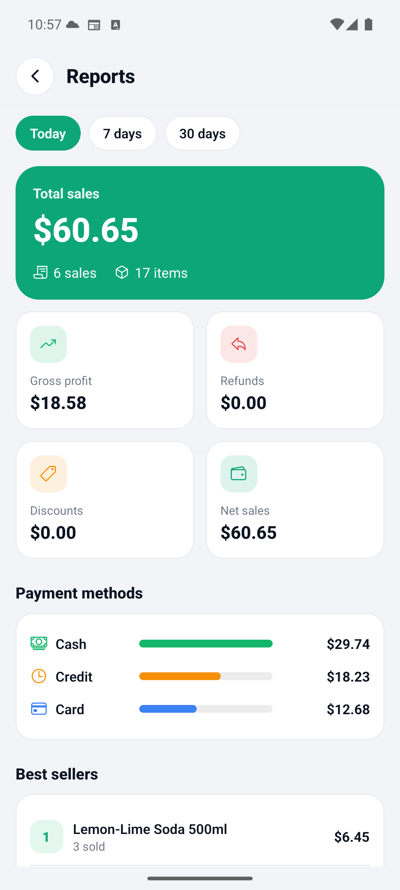
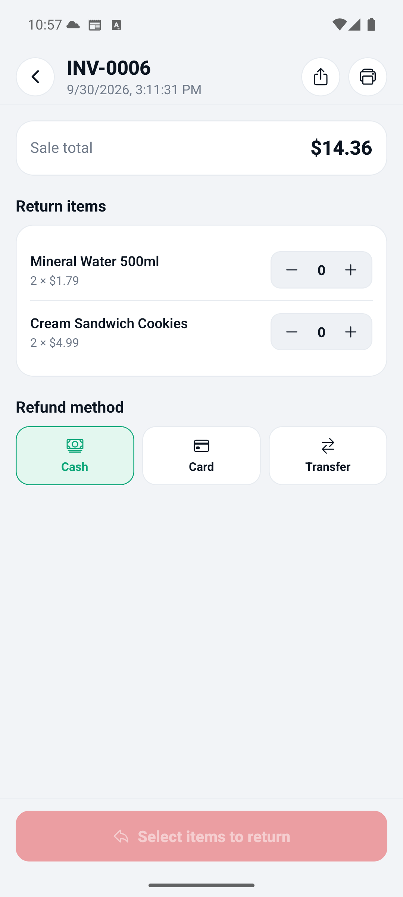
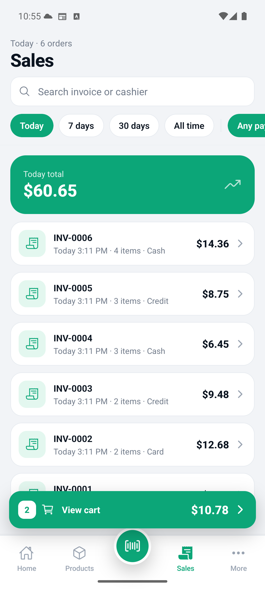
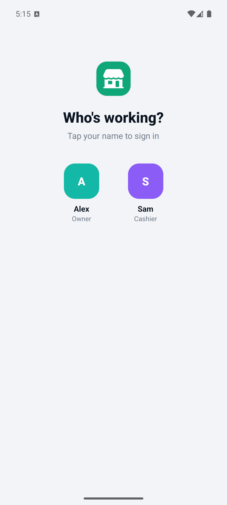
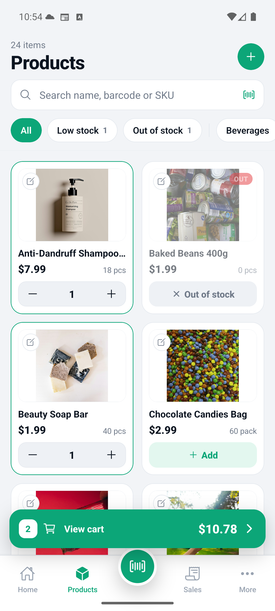

<div align="center">

# Surtivox POS

**Un punto de venta libre y offline que vive en tu bolsillo.**

Maneja tu negocio desde tu Android o iPhone — vende, imprime recibos, controla
el inventario y consulta tus ganancias, sin cuenta y sin necesidad de internet.
Respaldo en la nube opcional y sincronización entre dispositivos.

[](https://github.com/digita1web/surtivox-pos/actions/workflows/ci.yml)
[](https://github.com/digita1web/surtivox-pos/actions/workflows/codeql.yml)
[](https://securityscorecards.dev/viewer/?uri=github.com/digita1web/surtivox-pos)
[](https://www.bestpractices.dev/projects/15134)
[](LICENSE)


[**Sitio web**](https://github.com/digita1web/surtivox-pos) · [**Funciones**](#funciones) · [**Documentación**](docs/) · [**Contribuir**](CONTRIBUTING.md)

</div>

---

<div align="center">
  
  
  
  
</div>

<div align="center">
  
  
  
  
</div>

---

## Por qué Surtivox

La mayoría de las apps de punto de venta asumen una conexión confiable, una
suscripción mensual y una cuenta de comerciante antes de registrar una sola
venta. Surtivox asume lo contrario: un teléfono, un tendero y una fila de
clientes.

- **Funciona en cualquier lugar.** Cada venta, producto y reporte se guarda en
  el dispositivo con SQLite. Nunca se necesita conexión para vender.
- **Sin cuenta para empezar.** Instala, ponle nombre a tu negocio y vende. El
  registro no es un muro delante del producto.
- **Los importes son exactos.** Todos los montos se guardan en unidades
  menores enteras (centavos), nunca en punto flotante. Impuestos, descuentos y
  cambio son exactos.
- **Tus datos son tuyos.** Código abierto (MIT); tus datos permanecen en tu
  dispositivo salvo que decidas respaldarlos.

## Funciones

| | |
|---|---|
| 🧾 **Cobro rápido** | Agrega productos o escanea códigos de barras al carrito; efectivo, tarjeta, transferencia o crédito de tienda; cambio y sugerencias de efectivo. |
| 📦 **Inventario** | Fotos reales de productos, categorías, SKU, códigos de barras, alertas de stock bajo por producto y avisos de agotado. |
| 📷 **Escaneo de códigos** | Escanea para vender o agregar un producto, con búsqueda en Open Food Facts que completa nombre e imagen y se guarda localmente para usarla sin conexión. |
| 👥 **Personal y roles** | PIN para dueño, gerente y cajero; cada venta queda asociada al cajero que la realizó, en pantalla y en el recibo. |
| 🖨️ **Recibos y facturas** | Recibos personalizables (térmico de 58/80 mm o A4); imprime por Bluetooth, Wi-Fi o USB, o comparte una factura PDF. |
| 📊 **Reportes** | Ventas diarias, semanales y mensuales, ganancia bruta, devoluciones, descuentos, medios de pago y productos más vendidos. |
| 🏪 **Múltiples tiendas** | Maneja varias tiendas separadas en un mismo dispositivo, cada una con sus productos, personal, recibos y libros. |
| ☁️ **Respaldo en la nube** *(opcional)* | Respalda tu negocio y sincroniza entre dispositivos. Vender sin conexión sigue siendo gratis. |
| 🌙 **Modo oscuro** | Tema claro y oscuro en toda la app. |

## Planes

- **POS offline — gratis para siempre.** Vender, inventario, personal, recibos
  y reportes no tienen costo y nunca necesitan conexión.
- **Respaldo en la nube — opcional.** Copia de seguridad automática y
  sincronización entre dispositivos; puedes cancelar cuando quieras.

## Tecnología

React Native (Expo + Expo Router) · TypeScript · SQLite · Zustand ·
monorepo con pnpm + Turborepo · Cloudflare Worker + D1 para sincronización
opcional · suscripciones dentro de la app mediante Google Play / App Store
(expo-iap).

```
surtivox-pos/
  apps/
    mobile/        # la app Expo (pantallas, repositorios, stores)
    sync-worker/   # backend opcional de sincronización con Cloudflare Worker + D1
  packages/
    pos-core/      # motor de dinero + precios + ganancias (unidades menores enteras, con tests)
    database/      # esquema SQLite, migraciones solo hacia adelante, metadatos de sincronización
    types/         # tipos compartidos de dominio y sincronización
  docs/            # arquitectura, base de datos, roadmap, capturas
```

## Ejecutar en local

Requiere Node ≥ 22 y pnpm 10.

```bash
pnpm install
pnpm test                     # ejecuta las suites de pos-core y database

cd apps/mobile
npx expo run:android          # o: npx expo run:ios (build de desarrollo; cámara y código de barras requieren nativo)
```

En el primer inicio configurarás tu negocio en dos pasos (nombre + recibo) y
ya podrás vender.

Consulta [docs/development.md](docs/development.md) para la configuración
completa y [docs/architecture.md](docs/architecture.md) para las reglas de
capas.

## Reportar errores y vulnerabilidades

¿Encontraste un error o tienes una idea? Abre un issue en
[github.com/digita1web/surtivox-pos/issues](https://github.com/digita1web/surtivox-pos/issues).
Revisamos los reportes con regularidad.

Para una **vulnerabilidad de seguridad**, no abras un issue público; sigue el
proceso privado descrito en [SECURITY.md](SECURITY.md).

## Licencia

MIT — consulta [LICENSE](LICENSE). Las contribuciones son bienvenidas; mira
[CONTRIBUTING.md](CONTRIBUTING.md).
