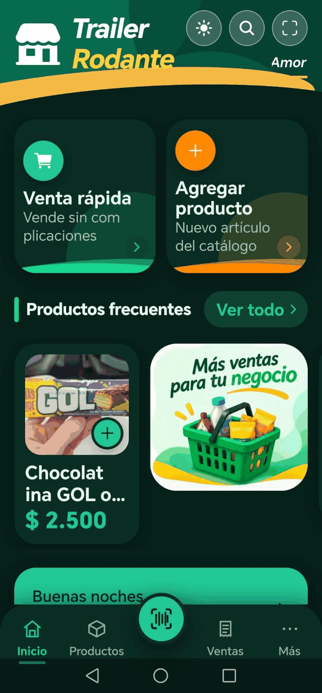
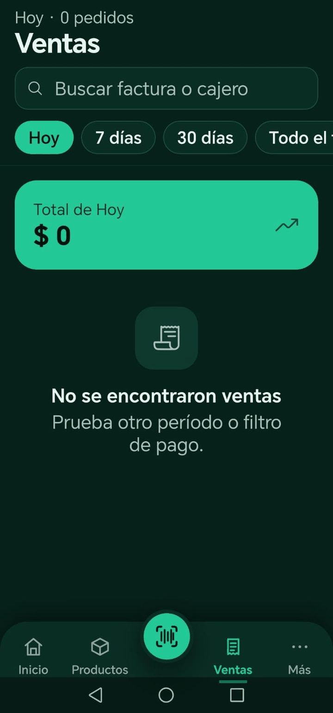
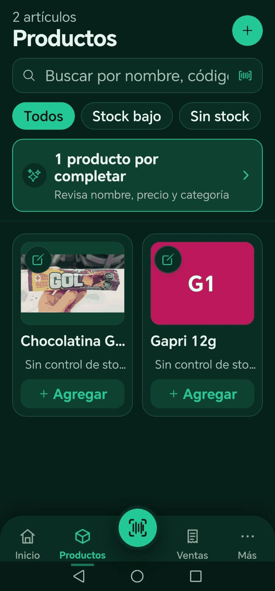
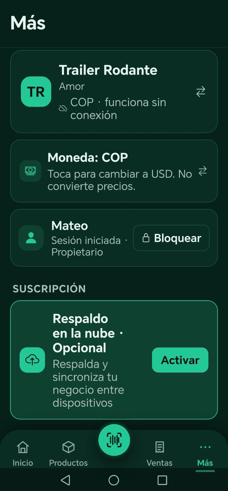

<div align="center">

# Surtivox POS

**Punto de venta offline para tiendas de barrio.**

Vende y controla tu tienda desde un teléfono Android. El inventario, los fiados
y los reportes se guardan en el dispositivo; el respaldo en la nube es opcional.
No necesitas crear una cuenta para empezar.

[](https://github.com/digita1web/surtivox-pos/actions/workflows/ci.yml)
[](https://github.com/digita1web/surtivox-pos/actions/workflows/codeql.yml)
[](https://securityscorecards.dev/viewer/?uri=github.com/digita1web/surtivox-pos)
[](LICENSE)


[**Sitio web**](https://digita1web.github.io/surtivox-pos/) · [**Descarga**](#descarga) · [**Funciones**](#funciones) · [**Documentación**](docs/)

**Software propietario - Todos los derechos reservados por Mateo Castro**

</div>

---

## Plataforma

Surtivox POS se distribuye hoy como **APK para Android**. El APK se publica en
GitHub Releases y el proceso de compilación está documentado en
[RELEASING.md](RELEASING.md).

## Descarga

- [Landing de Surtivox POS](https://digita1web.github.io/surtivox-pos/)
- [Descargar Surtivox.apk](https://github.com/digita1web/surtivox-pos/releases/latest/download/Surtivox.apk)

Si el navegador avisa que el archivo puede ser dañino, toca **Descargar de todos modos**.

<div align="center">
  
</div>

---

<div align="center">
  
  
  <br />
  
  
</div>

---

## Funciones

- **Ventas y cobro:** agrega productos o escanea códigos de barras; cobra en
  efectivo, tarjeta, transferencia, billeteras o fiado. Calcula el cambio y
  descuenta el inventario.
- **Inventario:** fotos de productos, categorías, SKU, códigos de barras,
  alertas de stock bajo y avisos de agotado.
- **Fiados:** clientes con saldo calculado a partir de un libro de movimientos;
  ventas a crédito, abonos y devoluciones a la cuenta del cliente.
- **Reportes:** consulta hoy, 7 días y 30 días; ventas, ganancia bruta,
  devoluciones, descuentos, métodos de pago y productos más vendidos.
- **Escáner y alta guiada:** escanea para vender o agregar un producto. Si el
  código no está registrado, la app ofrece registrarlo paso a paso con foto
  opcional, nombre, marca, tamaño, categoría y precio.
- **Recibos:** recibos de 58 mm, 80 mm y A4 mediante el servicio de impresión del sistema o PDF.
- **Precios de referencia:** cuando hay conexión, consulta precios de
  supermercados en COP como ayuda para fijar el precio. No cambia precios,
  inventario ni ventas.
- **Catálogo comunitario opcional:** si aceptas participar, la app puede
  aportar código, nombre y presentación de productos nuevos. Sin tu
  consentimiento no se envían aportes.
- **Respaldo en la nube opcional:** respalda y sincroniza la tienda entre
  dispositivos. Al activarlo se crea un kit de recuperación de 8 palabras.
  Hoy el respaldo está en modo de prueba.
- **Modo sin internet:** se vende sin internet; la consulta de productos, el catálogo y los precios de referencia necesitan conexión.

También incluye personal con PIN y roles, varias tiendas en el mismo teléfono y
tema claro u oscuro.

## Cómo se protege la información

- Los datos de la tienda, las ventas, los productos, los clientes y los fiados
  se guardan localmente en SQLite.
- El respaldo en la nube es opcional. Si no lo activas, la tienda no se sube al
  servicio de sincronización; las fotos de productos tampoco se sincronizan.
- Los aportes al catálogo comunitario solo se envían si activaste la
  participación. Incluyen código, nombre, presentación y un identificador
  aleatorio de la instalación; no incluyen precios, ventas, clientes ni el
  nombre de la tienda.
- La consulta de un código desconocido envía únicamente el código a Open Food
  Facts y al catálogo comunitario para buscar coincidencias. Los precios de
  referencia también se consultan con el código de barras. Como en cualquier
  conexión, el servicio que responde puede ver la dirección IP.
- No se encontró analítica en la app.

## Fuentes de datos y atribuciones

La app puede consultar nombres, marcas e imágenes de productos en
[Open Food Facts](https://world.openfoodfacts.org). Su base de datos está
disponible bajo la
[Open Database License (ODbL) 1.0](https://opendatacommons.org/licenses/odbl/1-0/),
el contenido individual bajo la Database Contents License (DbCL) y las fotos de
productos bajo Creative Commons Attribution-ShareAlike (CC BY-SA). Las imágenes
y marcas de productos pertenecen a sus respectivos titulares. Surtivox POS no
modifica precios, inventario ni ventas a partir de esos datos externos.

La pantalla **Licencias y atribuciones** de la app reúne estos avisos.

## Desarrollo

Surtivox POS es un monorepo con pnpm. Requiere Node ≥ 22 y pnpm 10.

```text
apps/
  mobile/           # app Expo + React Native para Android
  sync-worker/      # respaldo/sincronización y precios de referencia
  catalog-worker/   # catálogo comunitario
  payments-worker/  # worker de pagos
packages/
  pos-core/         # dinero, precios, ganancias y kit de recuperación
  database/         # esquema SQLite, migraciones y sincronización
  types/            # tipos compartidos
```

```bash
pnpm install
pnpm test           # pruebas de los paquetes y workers
./scripts/verify.sh # typecheck y pruebas de apps/mobile
```

El release de Android se explica en [RELEASING.md](RELEASING.md). La
configuración de desarrollo y las reglas de arquitectura están en
[docs/development.md](docs/development.md) y
[docs/architecture.md](docs/architecture.md).

## Contacto y seguridad

Para errores o ideas, abre un issue en
[github.com/digita1web/surtivox-pos/issues](https://github.com/digita1web/surtivox-pos/issues).
Contacto: [pragramademateo@gmail.com](mailto:pragramademateo@gmail.com).

Para una **vulnerabilidad de seguridad**, no abras un issue público; sigue el
proceso privado descrito en [SECURITY.md](SECURITY.md).

## Licencia

**Software propietario. © 2026 Mateo Castro (Surtivox POS). Todos los derechos
reservados.** Consulta [LICENSE](LICENSE). Para una licencia comercial, usa el
canal indicado en ese archivo.

El código base inicial fue heredado de OpenPocket POS (licencia MIT); su aviso
original se conserva en [LICENSES/MIT_LICENSE.txt](LICENSES/MIT_LICENSE.txt).
Consulta también [NOTICE.md](NOTICE.md).
